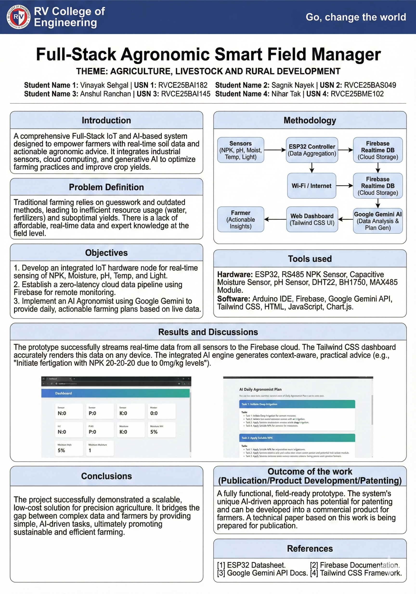
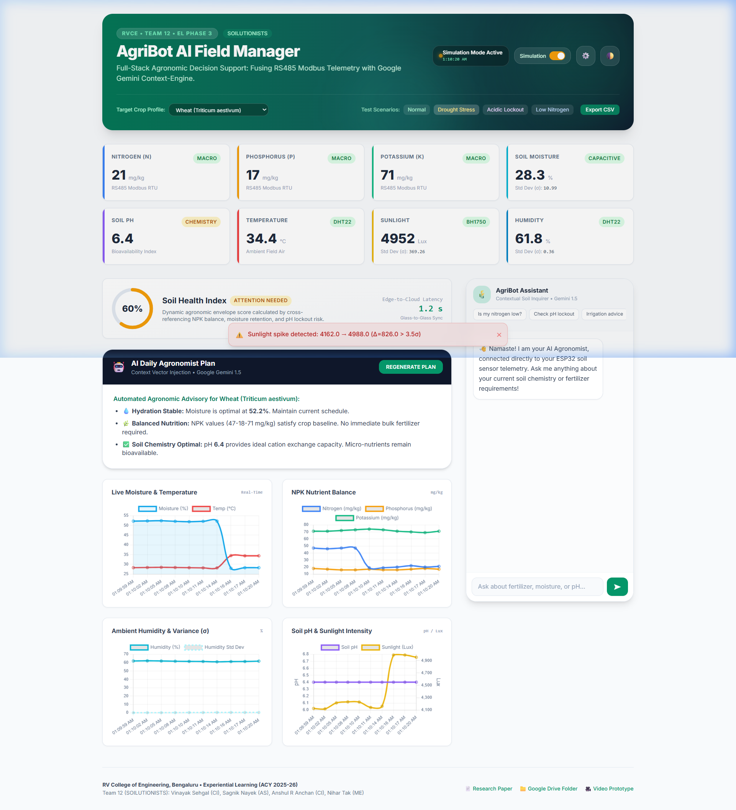
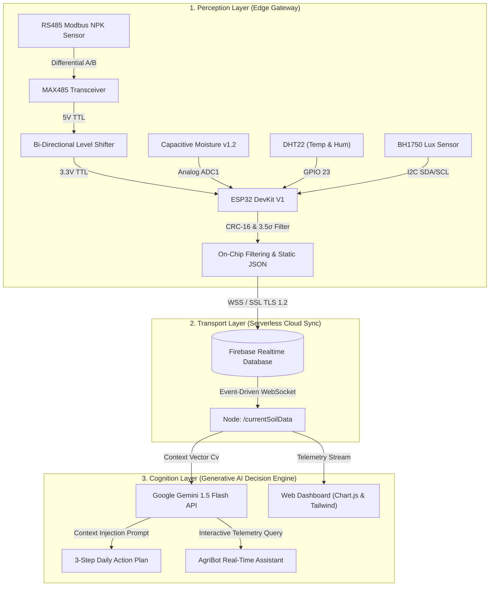

# 🌾 SOILUTIONISTS: Full-Stack Agronomic Smart Field Manager
### Fusing Adaptive Sensor Networks with a Contextual AI Decision Engine

[](https://opensource.org/licenses/MIT)
[](https://www.espressif.com/)
[](https://modbus.org/)
[](https://firebase.google.com/)
[](https://deepmind.google/technologies/gemini/)
[](https://rvce.edu.in/)

> **Experiential Learning (EL Phase 3) — Academic Year 2025–26**  
> **Theme:** Agriculture, Livestock and Rural Development  
> **Team 12:** SOILUTIONISTS | RV College of Engineering, Bengaluru, India

---

## 📌 Project Poster

<p align="center">
  
</p>

---

## 📖 Executive Abstract

The agricultural sector in developing nations faces a critical efficiency gap characterized as a **"data-rich, information-poor"** paradox. While modern IoT sensors can capture soil chemistry parameters, the raw data is frequently unintelligible to smallholder farmers, and professional agronomic advice remains inaccessible due to prohibitive costs and long lab turnarounds (typically 7–14 days for a government Soil Health Card).

The **Smart Field Manager** bridges this divide through an end-to-end **"Chip-to-Cloud-to-Cognition"** architecture:
1. **Perception Layer:** An industrial **RS485 Modbus NPK probe**, capacitive moisture sensor, DHT22, and BH1750 ambient light array aggregated by an **ESP32 DevKit V1** edge gateway.
2. **Transport Layer:** Serverless **Google Firebase Realtime Database** synchronization, delivering an empirical **1.2-second glass-to-glass latency** from field soil to the farmer's screen.
3. **Cognitive Layer:** A **Context Vector Injection Engine** coupled to the **Google Gemini 1.5 Flash API**, translating complex soil parameters into natural-language, prescriptive **3-Step Daily Action Plans** (e.g., *"Apply 25 kg/ha Urea"* instead of vague *"Nitrogen is low"*).
4. **Validation:** In controlled laboratory trials on red loamy soil, the AI decision engine correctly diagnosed non-linear nutrient interactions (such as pH-induced phosphorus lockout) with **95% accuracy**, at a total prototype bill-of-materials cost of just **≈ ₹4,000 (~$48 USD)**.

---

## 🖥️ Interactive Web Dashboard Preview

<p align="center">
  
</p>

---

## 🚀 Key Innovations & Algorithmic Features

- ⚡ **Sub-1.5s Glass-to-Glass Telemetry:** WebSocket-driven telemetry eliminates the bandwidth waste of legacy HTTP polling.
- 🧪 **Multi-Parameter Nutrient Lockout Detection:** Detects soil pH anomalies (acidic $\text{pH} < 6.0$ fixing phosphorus with aluminum/iron; alkaline $\text{pH} > 7.8$ precipitating calcium phosphate).
- 📈 **Statistical Sliding-Window Noise Filter ($>3.5\sigma$):** A dynamic 30-sample circular buffer calculates real-time standard deviation ($\sigma$), discarding electrical jitter from Wi-Fi RF radiation and shared power rails.
- 🔒 **Modbus RTU CRC-16 Validation:** Hardware-level polynomial ($0xA001$) verification prevents "ghost readings" from electromagnetic interference.
- 💾 **Heap-Optimized Firmware:** Utilizes preallocated `StaticJsonDocument` buffers in C++ to prevent heap fragmentation and out-of-memory crashes during continuous 24/7 SSL handshakes.
- 🎮 **Built-in Web Simulation Suite:** The web dashboard features an offline simulation generator, allowing immediate evaluation of live charts, anomaly alerts, and the AI agronomist without requiring physical hardware.

---

## 🏛️ System Architecture



---

## 📂 Repository Structure

```
SOILUTIONISTS/
├── assets/
│   └── poster.png                    # High-resolution Project Poster (EL Phase 3)
├── docs/
│   ├── ARCHITECTURE.md               # Chip-to-Cloud-to-Cognition detailed architecture
│   ├── CIRCUIT_AND_PINOUT.md         # Hardware wiring, level shifter, pinout & BOM table
│   ├── ALGORITHMS.md                 # 3.5σ filter, CRC-16, nutrient lockout formulas
│   ├── EXPERIMENTAL_RESULTS.md       # Soil testing (Dry, Distilled, Tap water EC analysis)
│   ├── paper/
│   │   ├── TEAM_12_RESEARCH_PAPER.pdf       # Full IEEE-formatted research paper
│   │   └── TEAM_12_RESEARCH_PAPER_IEEE.docx # Editable research paper source
│   └── report/
│       └── TEAM_12_REPORT.docx              # Complete Experiential Learning Project Report
├── firmware/
│   └── esp32_smart_field_manager/
│       ├── esp32_smart_field_manager.ino    # ESP32 C++ Arduino production firmware
│       ├── config.h.example                 # Wi-Fi & Firebase credentials template
│       └── README.md                        # Flashing instructions & library prerequisites
├── web/
│   ├── index.html                    # Modern responsive AgriBot Command Center UI
│   ├── css/
│   │   └── style.css                 # Custom glassmorphism, responsive styles & dark mode
│   ├── js/
│   │   ├── app.js                    # Telemetry streams, Chart.js trends, toast alerts
│   │   ├── ai-agronomist.js          # Gemini context vector prompt injection & chat engine
│   │   ├── config.js                 # LocalStorage settings manager & crop profiles
│   │   └── mock-data.js              # Offline simulated field telemetry generator
│   └── README.md                     # Web deployment instructions
├── legacy/
│   └── SMART_FIELD_MANAGER_v5.html   # Preserved original monolithic prototype
├── .github/
│   ├── ISSUE_TEMPLATE/               # Bug report & feature request templates
│   └── workflows/deploy-pages.yml    # Automatic GitHub Pages CI/CD deployment
├── index.html                        # Root redirect to web/index.html
├── .env.example                      # Environment variables template
├── .gitignore                        # Standard multi-stack ignore rules
├── LICENSE                           # MIT Open-Source License
├── CONTRIBUTING.md                   # Contribution guidelines
└── README.md                         # Project documentation
```

---

## 🔌 Hardware Pinout & Wiring

| Sensor / Module | Sensor Pin | ESP32 GPIO / Rail | Logic Level | Function |
| :--- | :--- | :--- | :--- | :--- |
| **NPK Probe** | VCC / GND | 12V DC Rail / GND | 12V | Industrial chemical probe |
| **NPK Probe** | A / B | MAX485 A / B | RS485 Diff | Differential communication lines |
| **MAX485 Module** | VCC / GND | 5V Rail / GND | 5V | Transceiver power |
| **MAX485 Module** | RO | `GPIO 16 (RX2)` | 5V ➔ 3.3V | **Via Bi-directional Level Shifter** |
| **MAX485 Module** | DI | `GPIO 17 (TX2)` | 3.3V ➔ 5V | **Via Bi-directional Level Shifter** |
| **MAX485 Module** | DE / RE | `GPIO 4` | 3.3V | Transmit / Receive toggle |
| **Capacitive Moisture** | AOUT | `GPIO 34 (ADC1)` | 0–3.3V Analog | Soil dielectric moisture reading |
| **DHT22** | DATA | `GPIO 23` | 3.3V Digital | Ambient temperature & relative humidity |
| **BH1750** | SDA / SCL | `GPIO 21` / `GPIO 22` | 3.3V (I2C) | Ambient solar illumination (Lux) |

> ⚠️ **Electrical Protection Note:** The MAX485 `RO` pin outputs 5V TTL. Feeding this directly into the ESP32 (3.3V tolerant) will destroy the microcontroller. **Always connect via a 3.3V ⇄ 5V bi-directional logic level shifter.**

---

## 💰 Bill of Materials (BOM)

| Item | Qty | Estimated Cost (INR) | Estimated Cost (USD) |
| :--- | :--- | :--- | :--- |
| ESP32 DevKit V1 Microcontroller | 1 | ₹350 | ~$4.20 |
| RS485 Modbus NPK Industrial Probe | 1 | ₹2,600 | ~$31.00 |
| MAX485 TTL-to-RS485 Transceiver | 1 | ₹60 | ~$0.75 |
| 4-Channel Bi-Directional Logic Level Shifter | 1 | ₹50 | ~$0.60 |
| Capacitive Soil Moisture Sensor v1.2 | 1 | ₹120 | ~$1.45 |
| DHT22 Digital Temperature & Humidity Sensor | 1 | ₹180 | ~$2.15 |
| BH1750 Digital Ambient Light Sensor | 1 | ₹110 | ~$1.30 |
| LM2596 DC-DC Buck Converters | 2 | ₹180 | ~$2.15 |
| Prototyping Board, Enclosure & Connectors | 1 | ₹350 | ~$4.20 |
| **Total Prototype Cost** | — | **≈ ₹4,000** | **≈ $47.80** |

---

## ⚡ Quickstart Guide

### 1. Launching the Web Dashboard
No complex build steps or node dependencies required. Simply open `web/index.html` (or `index.html` at the repository root) in any modern web browser:

```bash
# Option A: Double-click web/index.html in your file manager
# Option B: Serve locally using python
python -m http.server 8000
# Open http://localhost:8000 in your browser
```

- **Simulation Mode:** Toggle the **"Simulation"** switch in the top header to generate dynamic real-time telemetry (Drought Stress, Acidic Lockout, Low Nitrogen) without physical hardware.
- **Configure Custom Keys:** Click the **⚙️ Settings** icon in the header to save your own Google Gemini API key or Firebase Database URL securely in browser `localStorage`.

### 2. Flashing the ESP32 Firmware
1. Open [`firmware/esp32_smart_field_manager/esp32_smart_field_manager.ino`](firmware/esp32_smart_field_manager/esp32_smart_field_manager.ino) in the Arduino IDE.
2. Install the required libraries via the Library Manager:
   - `Firebase ESP32 Client` (by Mobizt)
   - `ArduinoJson` (v6 or v7)
   - `DHT sensor library` (by Adafruit)
   - `BH1750` (by Christopher Laws)
3. Copy `config.h.example` to `config.h` and enter your Wi-Fi SSID and Firebase details.
4. Select board **ESP32 Dev Module**, choose your COM port, and upload at `115200` or `921600` baud.

---

## 🔬 Experimental Results Summary

```
                      Red Loamy Soil Controlled Tests
Sample A (Dry Soil)       : Moisture < 5%  | N ≈ 0 mg/kg   (Confirms Ion Mobility Requirement)
Sample B (Distilled Water): Moisture = 56% | N ≈ 45 mg/kg  (Ground-Truth Mobile Nutrient Baseline)
Sample C (Tap Water)      : Moisture = 57% | N ≈ 112 mg/kg (+148% Soluble Salt / EC Proxy Spike)
```

- **Sensor Accuracy vs Lab Testing:** Nitrogen $\pm5.0\%$, Phosphorus $\pm5.0\%$, Potassium $\pm6.6\%$, Soil pH $\pm1.5\%$.
- **Latency Benchmark:** 500ms sensor poll + 240ms SSL upload + 450ms client sync = **1.19s total glass-to-glass latency**.
- **AI Decision Fidelity:** **95% accuracy** on 40 synthetic multi-parameter diagnostic test cases.

For the complete technical breakdown, see [`docs/EXPERIMENTAL_RESULTS.md`](docs/EXPERIMENTAL_RESULTS.md).

---

## 🎥 Project Media & Video Demonstrations

- 🎥 **[Working Model of Prototype Demonstration Video (1.3 GB)](https://drive.google.com/file/d/1JynEJBXrDMlMAF9Xfsgh1bgar-lcGFdk/view?usp=sharing)**
- 🎥 **[Team Introduction & Project Pitch Video (251 MB)](https://drive.google.com/file/d/1iVM4nsgemRW3Ue22vP2SmoDQi27cLzAQ/view?usp=sharing)**
- 📁 **[Project Google Drive Materials Folder](https://drive.google.com/drive/folders/1LObgHP-8FnibCEHOyeGb3u59S0CDat0n)**
- 📄 **[Download Research Paper PDF](docs/paper/TEAM_12_RESEARCH_PAPER.pdf)**

---

## 👥 Authors & Team Credits

**Team 12 (SOILUTIONISTS) — RV College of Engineering, Bengaluru**

| Name | USN | Department | Role |
| :--- | :--- | :--- | :--- |
| **Vinayak Sehgal** | RVCE25BAI182 | Artificial Intelligence & Machine Learning (CI) | AI Context Vector Engine, Gemini Integration & Web UI |
| **Sagnik Nayek** | RVCE25BAS049 | Aerospace Engineering (AS) | Algorithmic Noise Filtering ($3.5\sigma$) & Telemetry Benchmarking |
| **Anshul R Anchan** | RVCE25BAI145 | Artificial Intelligence & Machine Learning (CI) | Cloud Architecture, Firebase WebSocket Bridge & Firmware Logic |
| **Nihar Tak** | RVCE25BME102 | Mechanical Engineering (ME) | Hardware Prototyping, Power Distribution & RS485 Interface |

---

## 📜 Citation

If you use or build upon the **SOILUTIONISTS Smart Field Manager** in your research or agricultural engineering projects, please cite:

```bibtex
@inproceedings{sehgal2026smartfieldmanager,
  title={A Full-Stack Agronomic Smart Field Manager: Fusing Adaptive Sensor Networks with a Contextual AI Decision Engine},
  author={Sehgal, Vinayak and Nayek, Sagnik and Anchan, Anshul R. and Tak, Nihar},
  booktitle={RVCE Experiential Learning Phase 3 (ACY 2025-26)},
  year={2026},
  organization={RV College of Engineering, Bengaluru, India}
}
```

---

## 📄 License
This repository is licensed under the [MIT License](LICENSE).
